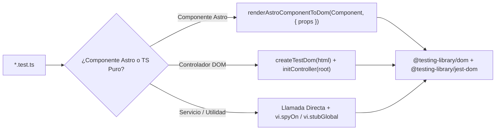

## 1. Arquitectura de Pruebas (`frontend/vitest.config.ts`)

La suite de pruebas del frontend utiliza **Vitest 4** con dos proyectos configurados en `frontend/vitest.config.ts`:
- **`unit`**: Ejecutor en Node/Happy-DOM para todos los archivos `src/**/*.test.ts` (92 archivos de prueba, 201 tests).
- **`storybook`**: Ejecutor en navegador Playwright Chromium para las historias de `@storybook/addon-vitest`.

---

## 2. Umbrales Obligatorios de Cobertura (`vitest.config.ts`)

| Métrica | Umbral Mínimo | Resultado Actual |
| :--- | :--- | :--- |
| **Statements** | `>= 80%` | **98.26%** |
| **Branches** | `>= 90%` | **90.93%** |
| **Functions** | `>= 95%` | **98.96%** |
| **Lines** | `>= 80%` | **99.28%** |

> **Nota**: `src/utils/test.helpers.ts` está incluido en las métricas de cobertura y cuenta con **100%** en las 4 categorías gracias a `src/utils/test.helpers.test.ts`.

---

## 3. Utilidades de Prueba (`frontend/src/utils/test.helpers.ts`)

| Función | Propósito |
| :--- | :--- |
| `renderAstroComponentToDom(Component, options)` | Usa `experimental_AstroContainer` para renderizar un componente `.astro` a HTML, lo monta en una ventana `happy-dom` y retorna `{ window, root, close }` |
| `createTestDom(html, options)` | Crea una ventana `happy-dom` síncrona, instala globales (`window`, `document`, `HTMLElement`, `CustomEvent`, `Event`, `SVGElement`) y retorna `{ window, document, root, close }` |
| `installDomGlobals(window, document)` | Vincula `globalThis.window`, `globalThis.document` y un `requestAnimationFrame` síncrono |
| `installMatchMedia(window)` | Configura `window.matchMedia` para que `(prefers-reduced-motion: reduce)` coincida por defecto en pruebas deterministas |
| `ensureDialogApi(dialog)` | Agrega polyfills para `showModal()`, `show()`, `close()` y `getAnimations()` en elementos `HTMLDialogElement` |
| `createUser(window)` | Configura `@testing-library/user-event` enlazado al documento `happy-dom` |
