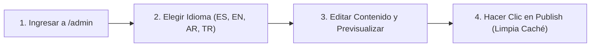

Esta guía está dirigida al **equipo administrativo y editorial de la Mezquita Central de Bogotá** que gestiona el contenido desde el Panel de Administración de Strapi v5 (`/admin`), disponible íntegramente en **Español (`es`), Inglés (`en`), Árabe (`ar`) y Turco (`tr`)**.

---

## 1. Gestión de Horarios de Oración, Yumu'ah y Avistamiento Lunar (Hilal)

1. En el menú lateral izquierdo, abre el plugin **Islam Suite** (`@vicacha-devs/strapi-plugin-islam`) o **Content Manager -> Islam, Liturgy & Scripture -> Hilal Announcement**.
2. Actualiza:
   - **Turnos de Jutbah y Oración de Yumu'ah** y **Offsets de Iqamah** para Fajr, Dhuhr, Asr, Maghrib e Isha.
   - **Anuncios de Avistamiento Lunar (`hilal-announcement`, `-2` a `+2` días)** cuando el avistamiento lunar ajuste el inicio de Ramadán, Eid al-Fitr o Dhul Hijjah.
3. Haz clic en **Save** y **Publish**.

---

## 2. Publicación de un Aviso Urgente en la Página Principal

Cuando se requiera anunciar un aviso prioritario (ej. horario de la oración de Eid, inicio de Ramadán o aviso de Janazah):
1. Abre **Content Manager -> Inbox & Omnichannel Broadcasts -> Alert Banner** (`plugin::inbox.alert-banner`) o el plugin **Inbox**.
2. Activa el banner, elige el nivel (`info`, `important`, `urgent`) y completa el título, resumen y enlace en `es`, `en`, `ar` y `tr`.
3. Al cambiar el identificador (`id`) del aviso, volverá a mostrarse incluso a los visitantes que habían cerrado un aviso anterior.

---

## 3. Creación de Eventos y Destacados en el Spotlight Dock (Becas / Convocatorias)

1. Ve a **Content Manager -> Events, Scheduling & Bookings -> Event** (`plugin::events.event`) y haz clic en **Create new entry**.
2. Completa **Title**, **Category**, **Schedule**, **Location** y **Body** (con el editor TipTap v3).
3. **Para destacar el evento en la ventana flotante de la esquina inferior (`EventSpotlightDock`)** (como las becas *Türkiye Bursları* o *Diyanet TDV*):
   - Activa `spotlightEnabled` en **True**.
   - Sube la imagen vertical del afiche en `poster`.
   - Define `spotlightBadgeText` (ej. `"Convocatoria Abierta"`), `spotlightPriority` y `spotlightEndAt` (fecha límite para el contador de días restantes).
4. Usa el selector superior **Locales** para traducir la entrada a `en`, `ar` y `tr`, y pulsa **Publish**.

---

## 4. Gestión de Donaciones, Zakat y Recibos de Servicios Públicos

1. **Campañas de Donación (`Content Manager -> Donations & Certificates -> Campaign`)**:
   - Actualiza `goalAmountCop`, `raisedAmountCop` y `donorCount` para reflejar el avance en `/[lang]/donate`.
2. **Canales de Pago (`Content Manager -> Public Website Pages -> Donations Page`)**:
   - Administra los datos de transferencia de Bancolombia, Nequi y Bre-B.
3. **Facturas de Servicios Públicos (`Donations Plugin -> Utility Invoices`)**:
   - Registra o actualiza el estado (`pending`, `partially_funded`, `paid`) de los recibos mensuales de Energía, Agua, Gas, Internet y Administración.
4. **Revisión de Aportes y Certificados (`Donations & Certificates -> Pledge` / `Certificate`)**:
   - Verifica los soportes enviados por los donantes y emite certificados firmados digitalmente con Ed25519 mediante el plugin **Certificates**.

---

## 5. Atención de Visitas Guiadas, Búsqueda Global y Purga de Caché

- **Reservas de Visitas (`Events, Scheduling & Bookings -> Booking`)**:
  - Revisa las solicitudes de colegios, universidades y visitantes (`visitorName`, `groupSize`, `startTime`) y cambia `status` de `pending` a `confirmed`.
- **Solicitudes de Servicios (`Inbox & Omnichannel Broadcasts -> Submission`)**:
  - Gestiona solicitudes de **temas de Jutbah**, **Matrimonio (Nikah)**, **Asistencia Funeraria (Janazah)**, **Citas de Shahada** y **Certificados Islámicos**.
- **Búsqueda Global (`Cmd/Ctrl + K`) y Purga de Caché (`strapi-cache v1.13.0`)**:
  - Presiona `Cmd+K` (o `Ctrl+K`) desde cualquier pantalla de `/admin` para buscar entradas en los 4 idiomas.
  - Al publicar una entrada la caché se limpia automáticamente, o puedes usar los botones **Purgar caché** / **Purgar caché de la entidad** (traducidos en `es`, `en`, `ar` y `tr`) directamente en el Content Manager.
