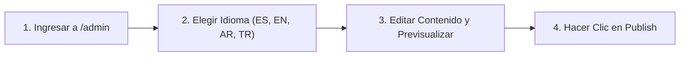

Esta guía está dirigida al **equipo administrativo y editorial de la Mezquita Central de Bogotá** que gestiona el contenido desde el Panel de Administración de Strapi v5 (`/admin`).

---

## 1. Gestión de Horarios de Oración y Yumu'ah

1. En el menú lateral izquierdo, abre **Content Manager -> Single Types -> Prayer Setting**.
2. Actualiza:
   - **Jumu'ah Khutbah Time** (ej. `12:15 PM`) y **Jumu'ah Prayer Time** (ej. `12:45 PM`).
   - **Iqamah Offsets** (`iqamahConfigs`) para Fajr, Dhuhr, Asr, Maghrib e Isha.
   - **Hijri Adjustment Days** (`-2` a `+2`) cuando el avistamiento lunar ajuste el inicio de Ramadán, Eid al-Fitr o Dhul Hijjah.
3. Haz clic en **Save** y **Publish**.

---

## 2. Publicación de un Aviso Urgente en la Página Principal

Cuando se requiera anunciar un aviso prioritario (ej. horario de la oración de Eid, inicio de Ramadán o aviso de Janazah):
1. Abre el plugin **Islam Suite** (`@vicacha-devs/strapi-plugin-islam`) o **Global Setting**.
2. Activa **Urgent Alert Banner**, elige el nivel (`info`, `important`, `urgent`) y completa el título, resumen y enlace en `es`, `en`, `ar` y `tr`.
3. Al cambiar el identificador (`id`) del aviso, volverá a mostrarse incluso a los visitantes que habían cerrado un aviso anterior.

---

## 3. Creación de Eventos y Destacados en el Spotlight Dock (Becas / Convocatorias)

1. Ve a **Content Manager -> Collection Types -> Event** y haz clic en **Create new entry**.
2. Completa **Title**, **Category**, **Schedule**, **Location** y **Body** (con el editor Tiptap).
3. **Para destacar el evento en la ventana flotante de la esquina inferior (`EventSpotlightDock`)** (como las becas *Türkiye Bursları* o *Diyanet TDV*):
   - Activa `spotlightEnabled` en **True**.
   - Sube la imagen vertical del afiche en `poster`.
   - Define `spotlightBadgeText` (ej. `"Convocatoria Abierta"`), `spotlightPriority` y `spotlightEndAt` (fecha límite para el contador de días restantes).
4. Usa el selector superior **Locales** para traducir la entrada a `en`, `ar` y `tr`, y pulsa **Publish**.

---

## 4. Gestión de Donaciones, Zakat y Recibos de Servicios Públicos

1. **Campañas de Donación (`Collection Types -> Donation Campaign`)**:
   - Actualiza `goalAmountCop`, `raisedAmountCop` y `donorCount` para reflejar el avance en `/[lang]/donate`.
2. **Canales de Pago (`Single Types -> Donations Page`)**:
   - Administra los datos de transferencia de Bancolombia, Nequi y Bre-B.
3. **Facturas de Servicios Públicos (`Donations Plugin -> Utility Invoices`)**:
   - Registra o actualiza el estado (`pending`, `partially_funded`, `paid`) de los recibos mensuales de Energía, Agua, Gas, Internet y Administración.
4. **Revisión de Comprobantes (`Collection Types -> Donation Submission`)**:
   - Verifica los soportes enviados por los donantes y emite certificados mediante el plugin **Certificates**.

---

## 5. Atención de Visitas Guiadas y Solicitudes Comunitarias

- **Reservas de Visitas (`Collection Types -> Visit Booking`)**:
  - Revisa las solicitudes de colegios, universidades y visitantes (`preferredDate`, `groupSize`) y cambia `status` de `pending` a `confirmed`.
- **Solicitudes de Servicios (`Inbox Plugin` / `Contact Submission`)**:
  - Gestiona solicitudes de **temas de Jutbah**, **Matrimonio (Nikah)**, **Asistencia Funeraria (Janazah)**, **Citas de Shahada** y **Certificados Islámicos**.
