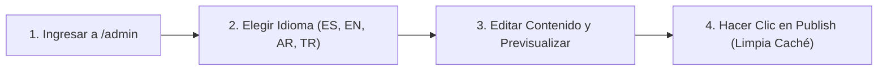

Esta guía está dirigida al **equipo administrativo y editorial de la Mezquita Central de Bogotá** que gestiona el contenido desde el Panel de Administración de Strapi v5 (`/admin`), disponible íntegramente en **Español (`es`), Inglés (`en`), Árabe (`ar`) y Turco (`tr`)**.



---

## 1. Gestión de Horarios de Oración, Yumu'ah y Avistamiento Lunar (Hilal)

1. En el menú lateral izquierdo, abre el plugin **Islam Suite** (`@vicacha-devs/strapi-plugin-islam`) o **Content Manager -> Islam, Liturgy & Scripture -> Hilal Announcement**.
2. Actualiza:
   - **Turnos de Jutbah y Oración de Yumu'ah** y **Offsets de Iqamah** para Fajr, Dhuhr, Asr, Maghrib e Isha.
   - **Anuncios de Avistamiento Lunar (`hilal-announcement`, `-2` a `+2` días)** cuando el avistamiento lunar ajuste el inicio de Ramadán, Eid al-Fitr o Dhul Hijjah.
3. Haz clic en **Save** y **Publish**.

---

## 2. Publicación de un Aviso Urgente en la Página Principal

Cuando se requiera anunciar un aviso prioritario (ej. horario de la oración de Eid, inicio de Ramadán o aviso de Janazah):
1. Abre **Content Manager -> Inbox & Omnichannel Broadcasts -> Alert Banner** (`plugin::inbox.alert-banner`) o el plugin **Inbox**.
2. Activa el banner, elige el nivel (`info`, `important`, `urgent`) y completa el título, resumen y enlace en `es`, `en`, `ar` y `tr`.
3. Al cambiar el identificador (`id`) del aviso, volverá a mostrarse incluso a los visitantes que habían cerrado un aviso anterior.

---

## 3. Creación de Eventos y Destacados en el Spotlight Dock (Becas / Convocatorias)

1. Ve a **Content Manager -> Events, Scheduling & Bookings -> Event** (`plugin::events.event`) y haz clic en **Create new entry**.
2. Completa **Title**, **Category**, **Schedule**, **Location** y **Body** (con el editor TipTap v3).
3. **Para destacar el evento en la ventana flotante de la esquina inferior (`EventSpotlightDock`)** (como las becas *Türkiye Bursları* o *Diyanet TDV*):
   - Activa `spotlightEnabled` en **True**.
   - Sube la imagen vertical del afiche en `poster`.
   - Define `spotlightBadgeText` (ej. `"Convocatoria Abierta"`), `spotlightPriority` y `spotlightEndAt` (fecha límite para el contador de días restantes).
4. Usa el selector superior **Locales** para traducir la entrada a `en`, `ar` y `tr`, y pulsa **Publish**.

---

## 4. Gestión de Donaciones, Zakat y Recibos de Servicios Públicos

1. **Campañas de Donación (`Content Manager -> Donations & Certificates -> Campaign`)**:
   - Actualiza `goalAmountCop`, `raisedAmountCop` y `donorCount` para reflejar el avance en `/[lang]/donate`.
2. **Canales de Pago (`Content Manager -> Public Website Pages -> Donations Page`)**:
   - Administra los datos de transferencia de Bancolombia, Nequi y Bre-B.
3. **Facturas de Servicios Públicos (`Donations Plugin -> Utility Invoices`)**:
   - Registra o actualiza el estado (`pending`, `partially_funded`, `paid`) de los recibos mensuales de Energía, Agua, Gas, Internet y Administración.
4. **Revisión de Aportes y Certificados (`Donations & Certificates -> Pledge` / `Certificate`)**:
   - Verifica los soportes enviados por los donantes y emite certificados firmados digitalmente con Ed25519 mediante el plugin **Certificates**.

---

## 5. Atención de Visitas Guiadas, Búsqueda Global y Purga de Caché

- **Reservas de Visitas (`Events, Scheduling & Bookings -> Booking`)**:
  - Revisa las solicitudes de colegios, universidades y visitantes (`visitorName`, `groupSize`, `startTime`) y cambia `status` de `pending` a `confirmed`.
- **Solicitudes de Servicios (`Inbox & Omnichannel Broadcasts -> Submission`)**:
  - Gestiona solicitudes de **temas de Jutbah**, **Matrimonio (Nikah)**, **Asistencia Funeraria (Janazah)**, **Citas de Shahada** y **Certificados Islámicos**.
- **Búsqueda Global (`Cmd/Ctrl + K`) y Purga de Caché (`strapi-cache v1.13.0`)**:
  - Presiona `Cmd+K` (o `Ctrl+K`) desde cualquier pantalla de `/admin` para buscar entradas en los 4 idiomas.
  - Al publicar una entrada la caché se limpia automáticamente, o puedes usar los botones **Purgar caché** / **Purgar caché de la entidad** (traducidos en `es`, `en`, `ar` y `tr`) directamente en el Content Manager.

---

## 6. Publicación de la Jutbah del Viernes y Transcripciones Multilingües

En el backend, los sermones de los viernes (**Jutbat al-Yumu'ah**) admiten tanto **grabaciones de audio/video** como **transcripciones escritas completas localizadas en `es`, `en`, `ar` y `tr`**.

### Opción A: Jutbah en Video / Audio + Transcripción Escrita (`Media Item` — Recomendado)
1. Ve a **Content Manager -> Media, Resources & Library -> Media Item** (`plugin::media-feeds.media-item`) o abre el plugin **Media Feeds** (`/admin/plugins/media-feeds`).
2. Haz clic en **Create new entry** y selecciona el idioma (`es`, `en`, `ar` o `tr`) en el selector superior derecho **Locales**:
   - **`title`**: Título de la Jutbah en el idioma activo.
   - **`slug`**: Identificador amigable para URL (ej. `khutbah-viernes-paciencia-y-gratitud`).
   - **`type`**: Selecciona **`khutbah`**.
   - **`sourceUrl`**: Pega el enlace de YouTube, Vimeo, Spotify o SoundCloud (el backend detecta automáticamente `provider`, `externalId` y `embedUrl`).
   - **`speaker`** y **`speakerProfile`**: Selecciona al Jatib (ej. *Sheikh Ahmad Al-Mansoor*).
   - **`publishedDate`**: Fecha del viernes (el backend calcula automáticamente la **fecha Hijri** `hijriDate`).
   - **`spokenLanguages`**: Arreglo JSON de idiomas hablados en el audio/video (ej. `["ar", "es"]`).
   - **`languageTracks`**: Pistas opcionales por idioma (`[{ "locale": "es", "label": "Español", "audioUrl": "...", "transcriptUrl": "..." }]`).
   - **`transcript`** *(Texto Enriquecido Localizado)*: Escribe o pega el **texto completo o traducción escrita de la Jutbah** en el idioma seleccionado (`es`, `en`, `ar` o `tr`).
3. Cambia el selector **Locales** arriba a la derecha a **`en`**, **`ar`** y **`tr`** para redactar el `title`, `description` y `transcript` en cada idioma, y pulsa **Publish**.

### Opción B: Jutbah Escrita como Artículo Independiente (`Article`)
Si deseas que una Jutbah escrita aparezca también como artículo de lectura en la sección **Artículos (`/[lang]/articles/[slug]`)**:
1. Ve a **Content Manager -> Collection Types -> Article** (`api::article.article`).
2. Define **`tag`** como `"Khutbah"` (o `"Jumu'ah"`), vincula **`authorProfile`** y redacta el cuerpo completo en **`content`** usando el editor TipTap en `es`, `en`, `ar` y `tr`.

---

## 7. Dónde y Cómo Agregar Clases y Lecciones Islámicas

Las lecciones islámicas se organizan en **4 tipos de contenido** según su formato:

| Formato de la Lección | Ubicación en Strapi Admin | UID del Content-Type | Ruta en el Frontend |
| :--- | :--- | :--- | :--- |
| **1. Halaqas en Vivo / Círculos de Estudio Semanales** | **Content Manager -> Events, Scheduling & Bookings -> Event** | `plugin::events.event` | `/[lang]/events` y `/[lang]/events/[slug]` |
| **2. Cursos Estructurados de la Academia** | **Content Manager -> Collection Types -> Course** | `api::course.course` | `/[lang]/education` |
| **3. Lecciones Escritas y Guías Educativas** | **Content Manager -> Collection Types -> Article** | `api::article.article` | `/[lang]/articles/[slug]` |
| **4. Series Grabadas en Audio / Video** | **Content Manager -> Media, Resources & Library -> Media Series & Media Item** | `plugin::media-feeds.media-series` y `plugin::media-feeds.media-item` | `/[lang]/media` |

- **Para Halaqas Semanales (`Event`)**: Selecciona `category` = **`education`**, indica `scheduleLabel` (ej. *"Sábados después de Maghrib"*), `speakerProfile` y `recurrenceRule` (`weekly`).
- **Para Cursos de la Academia (`Course`)**: Completa `title`, `level` (`beginner`, `intermediate`, `advanced`), `modality` (`in-person`, `online`, `hybrid`), `schedule`, `instructor` y `syllabus`.
- **Para Series Grabadas (`Media Series` + `Media Item`)**: Crea primero la serie en **Media Series** (ej. *Introducción al Fiqh*) y luego cada episodio en **Media Item** con `type` = **`video`** o **`podcast`**, enlazándolo mediante la relación `series` y añadiendo su `transcript` localizado.

---

## 8. Cómo Agregar y Editar Plantillas de Correo Institucional en Email Designer 5

El backend integra **`@Publishable/strapi-plugin-email-designer-5`** (`/admin/plugins/email-designer-5`), que gestiona dos pestañas de plantillas:

1. **Custom Templates (`plugin::email-designer-5.email-template`)**:
   - Sembradas automáticamente al iniciar por [`seedEmailDesignerTemplates`](file:///Users/sjoseluis/Projects/experiments/central-mosque-bogota/backend/src/seed/cms-seed-data.ts) con 3 plantillas institucionales de la **Mezquita Central de Bogotá** (encabezado esmeralda `#1B4332`, borde dorado `#D4AF37` y pie institucional):
     - **`101`**: *Mezquita Central — Confirmación de Solicitud y Ventanilla (Inbox)*
     - **`102`**: *Mezquita Central — Confirmación de Visita Guiada / Reserva*
     - **`103`**: *Mezquita Central — Boletín Comunitario y Horarios de Yumu'ah*
2. **Core Email Templates (`Reset Password` y `Email Address Confirmation`)**:
   - Almacenadas en el store interno de Strapi (`plugin_users-permissions_email`) y preconfiguradas con el diseño institucional esmeralda y dorado.

### Cómo Crear una Nueva Plantilla con la Marca de la Mezquita
1. Abre **Email Designer** (`/admin/plugins/email-designer-5`) en la barra lateral izquierda.
2. Para conservar el encabezado y pie de página institucionales, haz clic en el icono **Duplicate** sobre la plantilla **`101`** (o pulsa **Create a new template**).
3. Configura:
   - **Template Reference ID**: Número único (ej. `104`).
   - **Template Name**: Nombre descriptivo (ej. `Mezquita Central — Recibo de Donación`).
   - **Subject**: Asunto del correo con variables Mustache (ej. `[Mezquita Central] Certificado {{certificateNumber}}`).
4. Diseña los bloques en el editor visual Unlayer usando variables dinámicas (`{{applicantName}}`, `{{referenceCode}}`, `{{details}}`) y haz clic en **Save**.
5. Para enviar la plantilla desde un servicio del backend:
   ```ts
   await strapi
     .plugin("email-designer-5")
     .service("email")
     .sendTemplatedEmail(
       { to: recipientEmail },
       { templateReferenceId: 104 },
       { applicantName, referenceCode, details }
     );
   ```

---

## 9. Sincronización Bidireccional entre Casework Inbox y Form Builder CMS

El plugin **Inbox & Service Desk** (`@vicacha-devs/strapi-plugin-inbox`, `/admin/plugins/inbox`) y **Forms** (`strapi-plugin-form-builder-cms`, `/admin/plugins/strapi-plugin-form-builder-cms`) funcionan mediante un puente bidireccional sincronizado:

- **Definiciones de Formularios (`formcraft_forms`)**: Las plantillas iniciales (`service-desk-application`, `general-contact`, `service-request`) y los formularios creados visualmente en Form Builder CMS aparecen automáticamente en Inbox.
- **Envíos y Tickets de Caso (`formcraft_submissions` ↔ `inbox_submissions`)**:
  - Los envíos a `/api/inbox/forms/:slug/submit` validan honeypot, límite de tasa y CAPTCHA, crean el ticket de atención (`INB-YYYYMMDD-XXXXXX`) con fecha Hijri y lista de verificación documental, y replican el registro en `formcraft_submissions`.
  - Los envíos realizados directamente en Form Builder CMS (o existentes en `formcraft_submissions`) se importan automáticamente a `inbox_submissions` mediante el hook `afterCreate`, durante `syncWithFormBuilderCms()` y al consultar la pestaña **Casework Inbox** (`listSubmissions()`).

