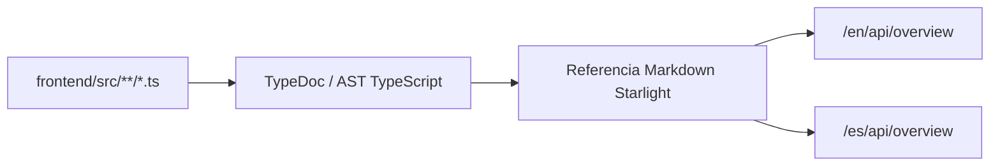

Esta referencia se genera directamente a partir del AST de TypeScript y las anotaciones JSDoc en `frontend/src/` mediante `docs/scripts/sync-typedoc.ts` y **TypeDoc** (`typedoc` + `typedoc-plugin-markdown`).

---

## Firmas Exportadas por Módulo

### `src/i18n/ui.ts`

- `const languages`
- `const localeFlags`
- `const defaultLang`
- `const ui`
- `type TLang`
- `const routes`
- `const showDefaultLang`

### `src/i18n/utils.ts`

- `function getLangFromUrl(url: URL): TLang`
- `function useTranslations(lang: TLang): unknown`
- `function getRouteFromUrl(url: URL): string | undefined`
- `function useTranslatedPath(lang: TLang): unknown`
- `function isSupportedLang(value: string | undefined): value is TLang`

### `src/utils/islamic.utils.ts`

- `const CONFIG`
- `function calculateActivePrayer(now: number, times: Record<TDailyPrayer, number | null>, sunriseMin: number | null): TDailyPrayer | null`

### `src/utils/location.utils.ts`

- `const LOCATION_CONFIG`
- `const BOGOTA_LOCATION`
- `const getClientLocation`
- `const invalidateLocationCache`

### `src/utils/maths.utils.ts`

- `const parseAmount`
- `const calculateProgress`

### `src/utils/positioning.utils.ts`

- `type ResolvePlacementOptions`
- `type ResolvePlacementResult`
- `function resolvePlacement(options: ResolvePlacementOptions): ResolvePlacementResult`
- `function getTransformOrigin(side: TDropdownPosition, align: TDropdownAlign): string`

### `src/utils/string.utils.ts`

- `function interpolate(template: string, vars?: Record<string, string | number>): string`
- `function slugifyFilenamePart(value: string): string`

### `src/utils/styles.utils.ts`

- `function cn(...inputs: Array<ClassValue>): string`

### `src/utils/time.utils.ts`

- `const parseTimeToMinutes`
- `const getCurrentMinutes`
- `const isTimeInRange`
- `const formatTime`
- `const formatYmd`
- `const isToday`
- `const formatYm`
- `const formatLongDate`
- `const formatHijriDate`
- `const getMonthAnchorDate`
- `const buildMonthLabel`
- `const buildMonthHref`

### `src/services/islamicAPI/api.ts`

- `type TIslamicApiQueryValue`
- `type TIslamicApiQueryParams`
- `const fetchIslamicData`
