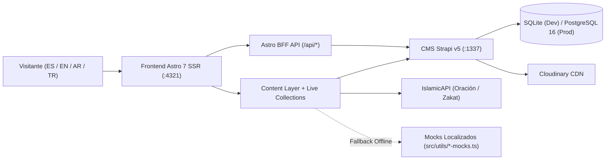

import { Card, CardGrid } from "@astrojs/starlight/components";

## Módulos de Documentación

<CardGrid stagger>
  <Card title="1. Inicio Rápido y Resumen (Jr. Devs)" icon="rocket">
    Domina el proyecto en 10 minutos con el [Resumen Ejecutivo para Jr. Devs](/es/01-getting-started/jr-dev-summary/), la [Guía de Onboarding](/es/01-getting-started/onboarding-guide/) y las [Variables de Entorno](/es/01-getting-started/environment-setup/).
  </Card>
  <Card title="2. Arquitectura y ADRs" icon="puzzle">
    Explora la [Visión General del Sistema](/es/02-architecture/system-overview/), [Astro 7 SSR y Capas de Contenido](/es/02-architecture/frontend-astro-ssr/), [Backend Strapi v5](/es/02-architecture/backend-strapi-v5/), [i18n y RTL Árabe](/es/02-architecture/i18n-and-rtl/) y los [ADRs 001–012](/es/02-architecture/adrs/).
  </Card>
  <Card title="3. Frontend en Detalle" icon="laptop">
    Comprende [Componentes y Controladores](/es/03-frontend/components-and-starwind/), [Loaders Resilientes y Mocks](/es/03-frontend/content-loaders-and-mocks/), [Motor IslamicAPI y Oración](/es/03-frontend/islamic-api-and-prayer-engine/), [Endpoints BFF](/es/03-frontend/bff-endpoints-and-forms/) y [Tiptap Rich Text](/es/03-frontend/tiptap-rich-text/).
  </Card>
  <Card title="4. Backend y Plugins Strapi v5" icon="setting">
    Inspecciona los [17 Esquemas de Strapi](/es/04-backend-and-plugins/content-types-and-schemas/), las [10 Extensiones Vicacha](/es/04-backend-and-plugins/vicacha-strapi-plugins/) y la [Semilla Inicial y Permisos](/es/04-backend-and-plugins/bootstrap-and-permissions/).
  </Card>
  <Card title="5. TODO de Verificación y QA" icon="approve-check">
    Ejecuta el [Checklist TODO de Verificación](/es/05-quality-and-verification/verification-todo-checklist/), la [Guía de Pruebas y Cobertura](/es/05-quality-and-verification/testing-and-coverage/), [Storybook y Accesibilidad](/es/05-quality-and-verification/storybook-and-a11y/) y el [Runbook Operativo](/es/05-quality-and-verification/operational-runbook/).
  </Card>
  <Card title="6. Manual Editorial y Referencia TypeDoc" icon="open-book">
    Comparte la [Guía Editorial de Strapi v5](/es/06-editorial-guide/cms-editor-handbook/) con el equipo de la Mezquita y consulta la [Referencia API TypeDoc](/es/api/overview/).
  </Card>
</CardGrid>

## Mapa General de la Plataforma (Renderizado con Pele)

